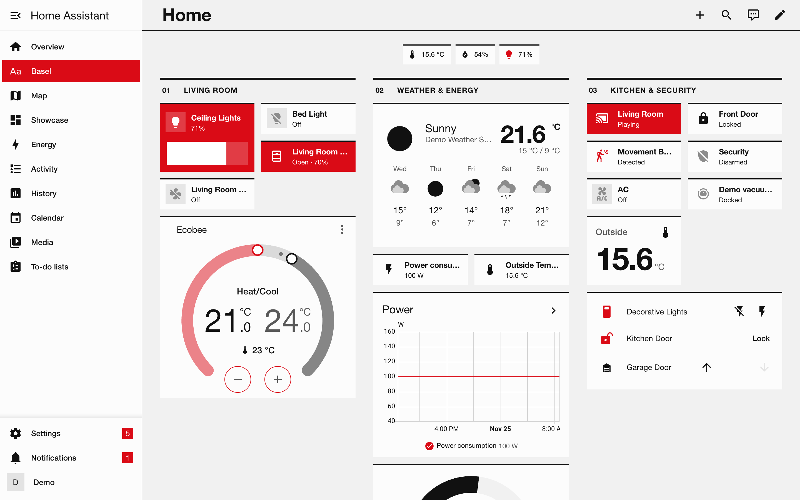
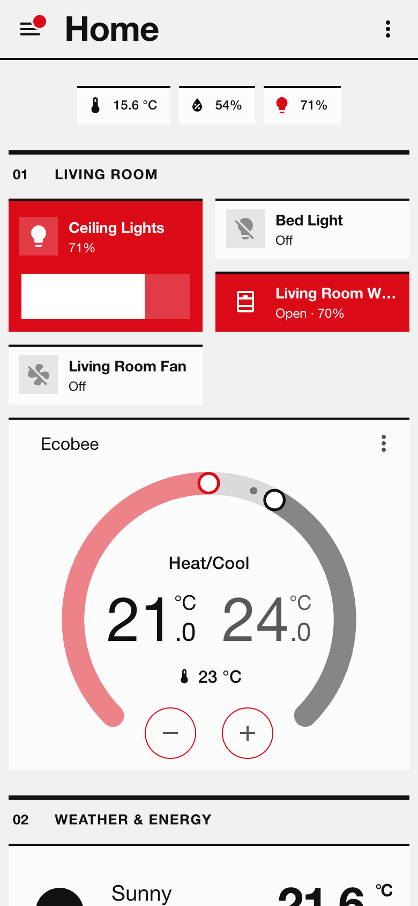
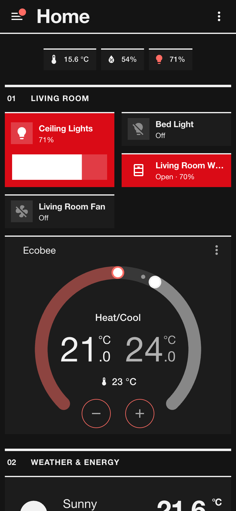
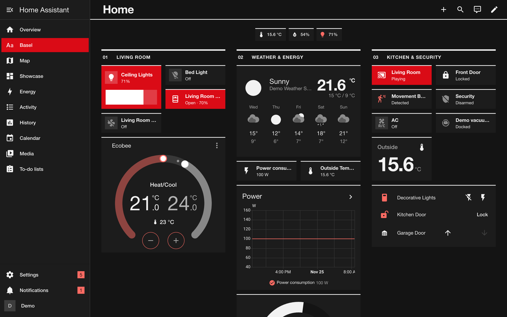
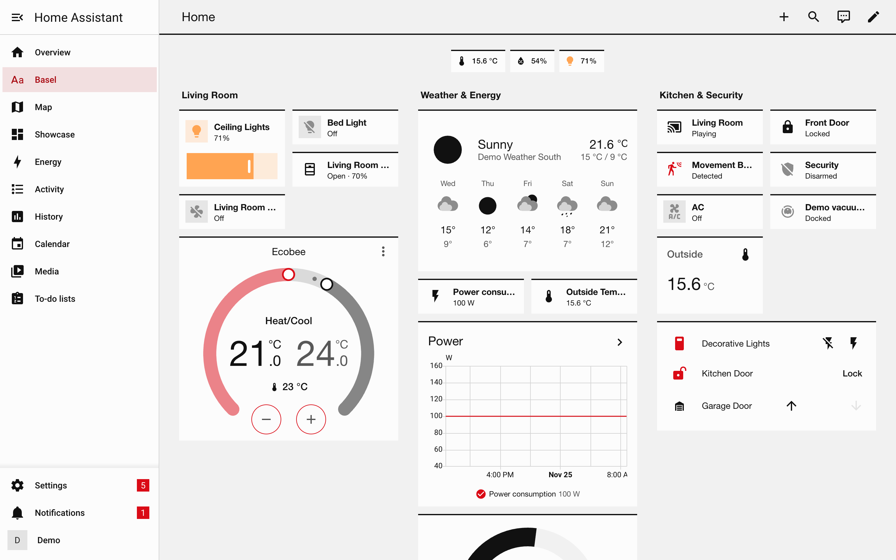
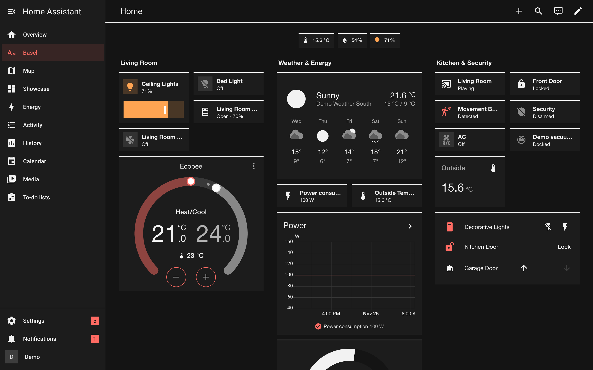
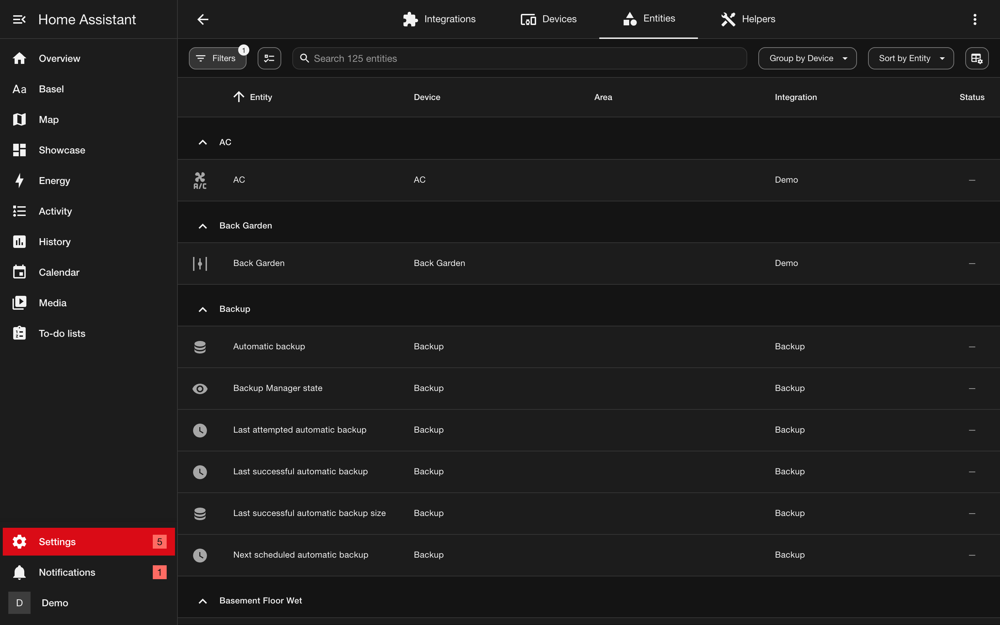
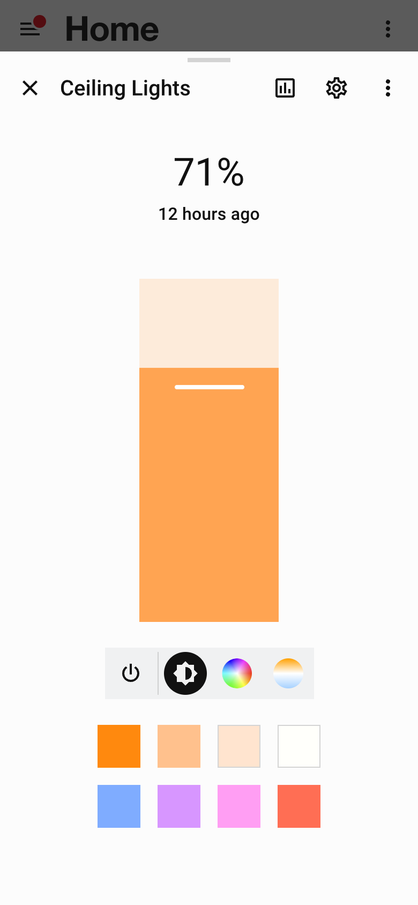
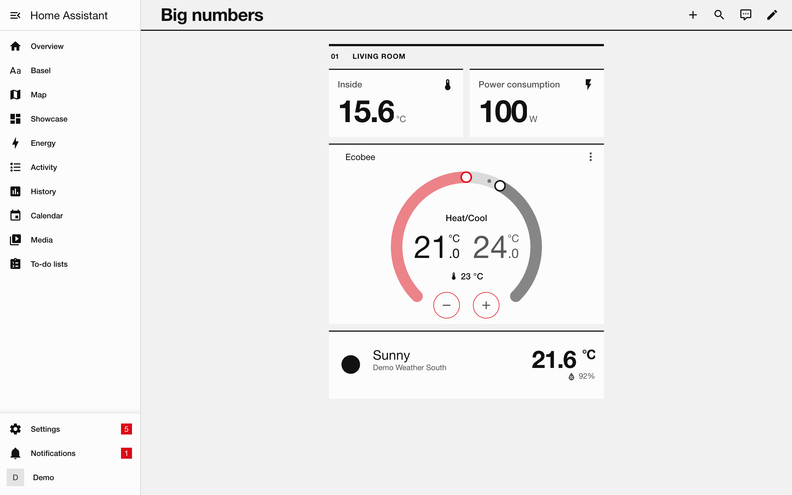

# Basel

[](https://my.home-assistant.io/redirect/marketplace_repository/?owner=wsclx&repository=basel-theme&category=theme)

A Home Assistant theme in the International Typographic Style, the Swiss poster style of the 1950s and 60s. Near-white paper, one signal red and black. A neo-grotesque sans set tight and flush left, square corners, no shadows. Cards are held apart by the grid and a thin black rule along their top edge; switched-on devices are solid red tiles with white text. Light and dark mode in one theme.



| Light | Dark |
|---|---|
|  |  |



## What you get

- **One red, black and paper.** Red marks what needs your eye: everything that is on, heating, lit, open or triggered, errors and alarms, and the selection. Buttons, links and tabs are black, calm states (cooling, locked, docked) are black, off is grey. Warnings are black on pale red, errors red on pale red, success and info black on grey, so no third hue turns up in buttons, alerts or chips.
- **Rules instead of frames.** No borders, no shadows, no rounded corners. Every card starts with a thin black rule, and the grid gap is a little wider so the columns read like a poster.
- **A neo-grotesque from the system:** Helvetica Neue on Apple devices, Arial on Windows, Nimbus Sans or Liberation Sans on Linux, the system sans on Android. Tile names and headings are bold and set tight. Nothing is downloaded.
- **Readable red.** White on red is 5.2:1, red text on the page 4.6:1 (WCAG AA). All text pairs and the colours of switches, fields, sliders and the keyboard focus were measured in both modes. A focused tile gets a 2 px ring in black (white in dark mode), also around solid red tiles.
- **Dark mode is its own design:** white and red on a deep black-grey with white rules. Red tiles keep white text; red text and icons use a lighter red that reads on dark grey. It is not an inverted light mode.
- **Optional extras with card-mod:** switched-on lights, switches, fans, media players, climate, covers and similar entities become solid red tiles, big numbers of entity, sensor and weather cards become large and bold, heading cards get a heavier rule, capitals and a running number (01, 02, 03 …) like on a poster, the thermostat title moves to the left, the dashboard title grows, coloured lights turn red in badges, and the selected sidebar entry becomes a red bar.

Without card-mod the theme still works: paper, rules, red, black and the font stay, switched-on devices show a red icon instead of a solid tile, and headings are bold without capitals.

| Without card-mod, light | Without card-mod, dark |
|---|---|
|  |  |





## Requirements

- Home Assistant with themes enabled. Tested with Home Assistant 2026.11.2 (November 2026).
- Optional: [card-mod](https://github.com/thomasloven/lovelace-card-mod) 4.x for the solid red tiles, the large numbers, the heading rules and the sidebar. Tested with card-mod 4.2.1.

## Installation

### Marketplace (HACS)

1. Open **Settings → Marketplace** (or HACS on older versions).
2. Search for **Basel** and download it.
3. Reload themes: **Developer tools → Actions → `frontend.reload_themes`**.

### Manual

1. Copy `themes/basel.yaml` into the `themes` folder of your configuration.
2. Make sure your `configuration.yaml` loads that folder:

   ```yaml
   frontend:
     themes: !include_dir_merge_named themes
   ```

3. Restart Home Assistant or run `frontend.reload_themes`.

## Use the theme

Open your **profile**, choose **Basel** under *Theme*, and pick *Auto*, *Light* or *Dark*.

## Big numbers

Poster-sized numbers come from the cards you choose, not from the theme alone. These standard cards show one large number:

```yaml
type: sections
sections:
  - type: grid
    cards:
      - type: heading
        heading: Living room
      - type: entity
        entity: sensor.living_room_temperature
        name: Inside
        grid_options:
          columns: 6
          rows: 2
      - type: sensor
        entity: sensor.power_consumption
        graph: none
        grid_options:
          columns: 6
          rows: 2
      - type: thermostat
        entity: climate.living_room
      - type: weather-forecast
        entity: weather.home
        show_forecast: false
```



- With card-mod, Basel sets the numbers of the entity and sensor card to 56 px bold and the temperature of the weather card to 44 px bold.
- Without card-mod they use Home Assistant's size `ha-font-size-3xl` (28 px). You can raise it in a copy of the theme, for example `ha-font-size-3xl: 44px`. It also enlarges a few other headings (empty pages, setup screens) and the target value in the humidifier dialog, which is why Basel leaves it at the default.
- The thermostat number is fixed at 57 px by the frontend and stays regular weight; the theme cannot make it bold.

## Optional: card-mod

The theme contains `card-mod-card`, `card-mod-badge`, `card-mod-root` and `card-mod-sidebar` rules. They only apply when card-mod is installed. For theme rules, card-mod recommends loading it as a frontend module instead of a dashboard resource:

```yaml
frontend:
  themes: !include_dir_merge_named themes
  extra_module_url:
    - /local/community/lovelace-card-mod/card-mod.js
```

Adjust the path to where card-mod is installed on your system.

The solid red tile applies to tile cards of these domains when they are on: `light`, `switch`, `fan`, `media_player`, `climate`, `input_boolean`, `humidifier`, `water_heater`, `vacuum`, `remote`, `siren`, `automation`, `script`, `cover`. Sensors are left out on purpose: the tile card marks every entity with a value as active.

## Customise

Change the variables below in a copy of the theme, or override them with card-mod.

| Variable | Used for |
|---|---|
| `basel-red`, `basel-on-red` | Red and text colour of solid tiles and the sidebar bar (card-mod) |
| `basel-rule` | Colour of the rule along the top of every card |
| `ha-card-box-shadow` | The rule itself (`inset 0 2px 0 …`); set `none` for cards without a rule |
| `basel-sans` | The font stack |
| `primary-color`, `ha-color-primary-*` | Ink of buttons, links and tabs |
| `ha-color-red-*`, `ha-color-orange-*` | Red of errors and alarms; pale red behind warnings |
| `switch-checked-track-color`, `control-slider-color` | Red of switches and sliders that are on |
| `lovelace-background`, `card-background-color` | Paper behind the cards and of the cards |
| `state-active-color`, `state-inactive-color` | Colour of on and off icons |
| `red-color`, `amber-color`, `blue-color`, `green-color` … | The palette behind all state colours: warm colours red, cool colours black |
| `graph-color-1` … `graph-color-5`, `energy-*-color` | Red, black and greys of graphs and the energy dashboard |

## Known limits

- Home Assistant does not guarantee theme variables between releases. If something looks off after an update, please open an issue with your version.
- **Coloured lights:** a light that reports a colour shows that colour in its tile icon, its brightness slider and its badge. The frontend sets it per light, so a theme cannot change it. With card-mod the tile turns red and the badge red; in the light's dialog the colour picker keeps its colours.
- Without card-mod a theme cannot fill a whole tile by its state, only the icon. The solid red tile needs card-mod, and so do the capitals and the heavier rule on heading cards.
- Badges stay centred above the sections; their alignment is fixed in the frontend.
- The running numbers count every heading card of a view in order. A view with two headings in one section gets two numbers.
- Switches keep their round shape, and round icons stay round: both are fixed in the frontend.
- The thermostat draws its heating range in a lighter red, its track in a light grey and keeps its number and buttons centred; all of this is fixed in the frontend.
- The sidebar keeps the frontend font (Roboto) without card-mod; card-mod switches it to the theme font.
- Weather icons are the frontend's filled icons; the theme sets them to black and grey.
- Camera images, maps, media artwork and entity pictures keep their own colours, and so do the round icons of the settings menu and the logos of integrations.
- The font depends on your device. Where none of the listed fonts is installed, the system sans is used.
- The card-mod rules target internal elements of the frontend. A frontend update can break them; the theme itself keeps working.

## Contributing

Issues and pull requests are welcome. Please include your Home Assistant version, card-mod version (if used), browser or app and a screenshot.

## License

[MIT](LICENSE)

This is a community project. It is not affiliated with or endorsed by Home Assistant or the Open Home Foundation.
